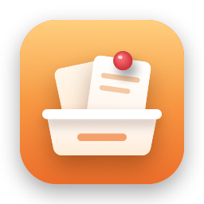
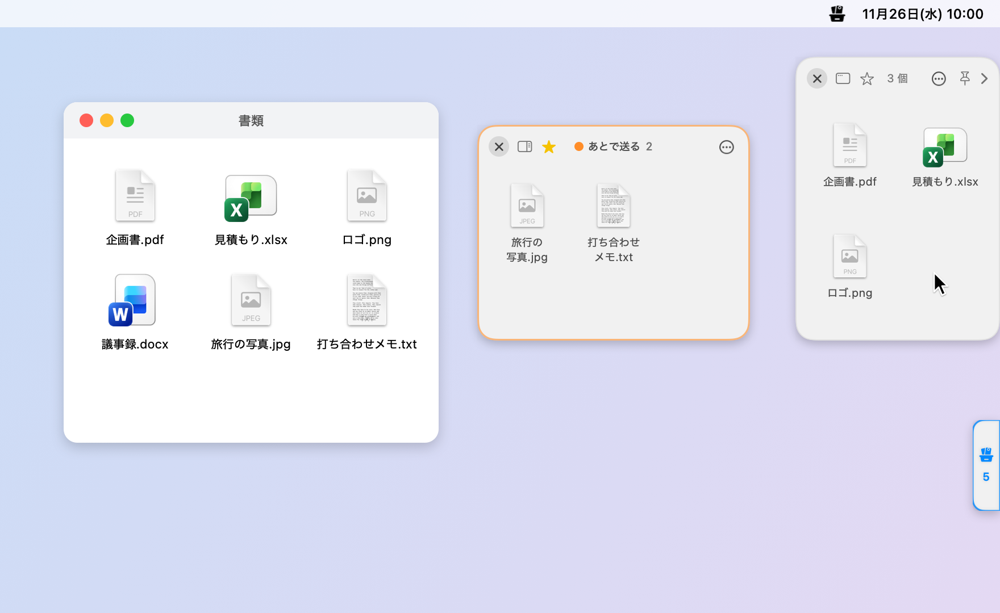
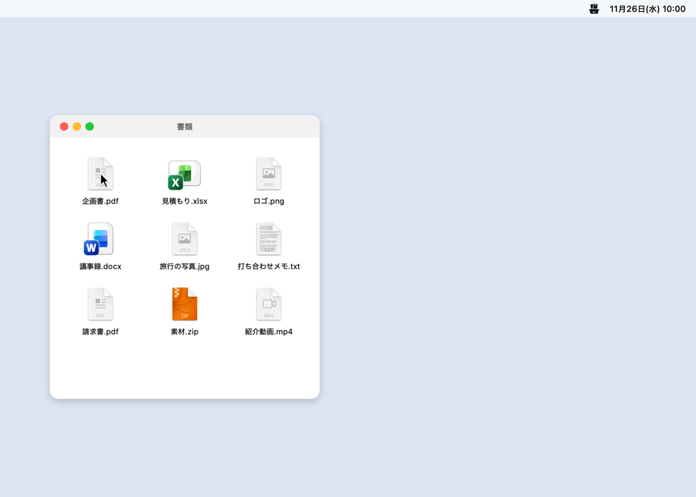
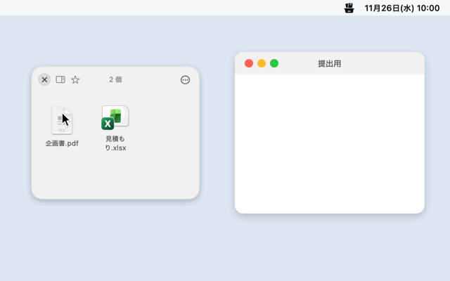
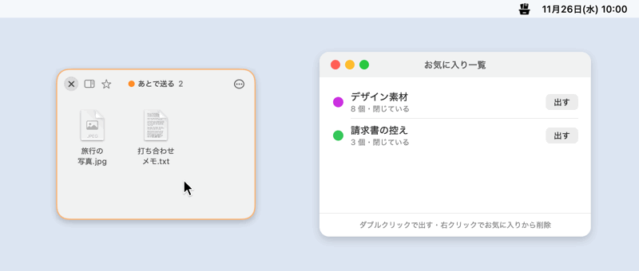

<p align="center">
  
</p>

<h1 align="center">Pinshelf</h1>

<p align="center">
  ドラッグ中のファイルを、画面の端や手元の「棚」に一時的に置いておける macOS のメニューバーアプリ
</p>

<p align="center">
  <a href="LICENSE"></a>
  
  
</p>

<p align="center">
  
</p>

> [!NOTE]
> **いまは β 版です。** 思わぬ不具合があるかもしれません。見つけたら [Issues](https://github.com/yzanbo/pinshelf/issues) で教えてください。操作や設定の保存形式は、正式版までに変わることがあります。

> **English:** Pinshelf is a macOS menu bar app that gives you a temporary "shelf" for the files you are dragging. Start a drag and a shelf slides out from the edge of the screen, or shake the cursor to open one right where you are. Drop files, text, or links on it, then drag them out wherever you need them. The UI is currently in Japanese.

## 使い方

1. **置く**：ファイルをドラッグし始めると、画面の端に細い帯が出ます。帯の近くまで運ぶと棚が開くので、そのまま落とします。離れると、棚は帯にたたみます

   <p align="center">
     
   </p>

2. **その場に出す**：ドラッグ中にマウスを軽く振るか ⇧ を押すと、カーソルの位置に棚が出ます。浮いた棚は、画面の端まで運ぶと帯にしまえます

   <p align="center">
     
   </p>

3. **取り出す**：棚からほかのアプリへドラッグします。Finder と同じく、同じディスクなら移動、⌥ を押しながらならコピーです。⌘L でロックしたものは、取り出しても棚に残ります

   <p align="center">
     
   </p>

4. **とっておく**：見出しの ☆ を押すと ★ になり、お気に入りの棚になります。閉じても中身ごと残り、メニューバーの「お気に入りの棚」や「お気に入り一覧…」から出し直せます

   <p align="center">
     
   </p>

## できること

- **画面の端に出す**：ファイルをドラッグし始めると、画面の端に細い帯が出ます。帯の近くまで運ぶと棚が開き、そのまま落とせます。左右どちらの端に出すか・出す高さ（カーソルの高さについてくることもできます）・出すときを選べます
- **振って出す・キーで出す**：ドラッグ中にマウスを軽く振るか、決めたキー（初期設定は ⇧）を押すと、カーソルの位置に棚が出ます
- **画面の端にしまう**：浮いた棚を画面の端まで運ぶと、細い帯にたたんでしまえます。帯の近くに来ると開き、離れるとたたみます。見出しのピンで、棚ごとに開いたままにもできます
- **取り出す**：棚からほかのアプリへドラッグで取り出せます（Finder と同じく、同じディスクなら移動、⌥ でコピー）。棚から棚へも移せます
- **中身の扱い**：Quick Look（スペースキー）・ロック（取り出しても残す）・スタック（一緒に置いたものをまとめる）・元に戻す（⌘Z）
- **棚の名前・色・お気に入り**：お気に入りの棚は閉じても中身ごと残り、メニューバーや「お気に入り一覧」から出し直せます。閉じた棚は「最近閉じた棚」から開き直せます
- **大きさ**：棚の縁をつかんで大きさを変えられます。画面の端にあるとき・浮いているときの標準の大きさも決められます
- **メニューバー・クリップボードから入れる**：メニューバーのアイコンに落とすか、ショートカット（初期設定は ⌥⇧V）で、コピー中のものを棚に入れられます
- **再起動しても残す**：棚の中身・位置・大きさを残し、再起動しても元に戻します。ログイン時に起動もできます
- アクセシビリティなどの許可は要りません。フルスクリーンのアプリの上や、別のデスクトップでも使えます

くわしい操作は [docs/USAGE.md](docs/USAGE.md) を見てください。

## ダウンロード

[Releases](https://github.com/yzanbo/pinshelf/releases) から `Pinshelf-<版>.dmg` をダウンロードして開き、`Pinshelf` を `Applications`（アプリケーションフォルダ）へドラッグしてください（`.zip` もあります。展開して `Pinshelf.app` を入れる形で、中身は同じです）。macOS 26 以降で、Intel と Apple Silicon のどちらの Mac でも動きます。

Apple の公証を受けていない（アドホック署名の）アプリなので、初めて開くときに「開発元を確認できない」と止められます。次のどちらかで開けます。

- 一度開こうとしたあと、システム設定 →「プライバシーとセキュリティ」の下の方にある「このまま開く」を押す
- ターミナルで `xattr -dr com.apple.quarantine /Applications/Pinshelf.app` を実行してから開く

開くと、メニューバーに Pinshelf のアイコンが出ます（Dock には出ません）。ファイルをドラッグし始めると、画面の端に棚が出ます。出し方は、メニューバーのアイコン →「設定…」で変えられます。

## ソースからビルド

自分でビルドする場合の手順です。自分の Mac でビルドしたアプリは、「開発元を確認できない」という警告が出ません。

### 用意するもの

- macOS 26 以降
- Xcode 26 以降（App Store から入れる。コマンドラインツールだけではビルドできません）
- [XcodeGen](https://github.com/yonaskolb/XcodeGen)

### 手順

```bash
brew install xcodegen
git clone https://github.com/yzanbo/pinshelf.git
cd pinshelf
make install
```

`make install` は配布用（Release）にビルドし、`/Applications/Pinshelf.app` に入れます。Intel と Apple Silicon のどちらの Mac でも動きます。終わったら、アプリケーションフォルダから Pinshelf を開いてください。

### 新しい版にする

```bash
cd pinshelf
git pull
make install
```

`make install` は、動いている Pinshelf を終了してから入れ替えます。棚の中身と設定はそのまま残ります。

署名なし（アドホック署名）でビルドしているため、ビルドし直すと macOS から別のアプリと見なされ、棚に置いたファイルを開けなくなることがあります。何度もビルドし直す場合は、下の `make cert` を使うと、同じアプリのまま扱われます。

### 削除

```bash
make uninstall
```

設定と棚の中身は残ります。すべて消すときは、`~/Library/Containers/app.pinshelf.Pinshelf` も削除してください。

## 開発するとき

| コマンド | 内容 |
|---|---|
| `make cert` | 開発用の署名の証明書「Pinshelf Dev」を作る（最初に一度だけ。任意） |
| `make run` | 動いている Pinshelf を終了し、開発用（Debug）にビルドして起動する |
| `make build` | 開発用にビルドするだけ |
| `make test` | テストを動かす（アプリは起動しない） |
| `make install` | 配布用にビルドして `/Applications` に入れる |
| `make uninstall` | `/Applications` から削除する（設定と棚の中身は残る） |
| `make dist` | Releases に置く DMG と zip（`dist/Pinshelf-<版>.dmg`・`.zip`・`.sha256`）を作る（アドホック署名） |
| `make publish` | DMG と zip を作り、GitHub に Release（タグ `v<版>`）を作ってアップロードする。β 版は `make publish BETA=1`（タグ `v<版>-beta.1`・プレリリース） |
| `make stop` | 動いている Pinshelf を終了する（棚を保存してから終わるのを待つ） |
| `make generate` | `Pinshelf.xcodeproj` を作るだけ（Xcode で開くとき） |
| `make icon` | アプリのアイコンを描き直す（`scripts/make-app-icon.swift` を変えたとき） |
| `make readme-images` | README の見本の画像（`docs/images/`）を作り直す（棚の見た目を変えたとき。作っている間、画面に棚やウィンドウが少し出る） |

`Pinshelf.xcodeproj` は `project.yml` から作るため、リポジトリには入れていません。Xcode で開いて ⌘R で動かすこともできます（`make generate` のあと `open Pinshelf.xcodeproj`）。

### `make cert` について

macOS は、棚に置いたファイルのブックマークや、サンドボックスの保存場所を、アプリの署名にひも付けて扱います。アドホック署名だと、ビルドし直すたびに別のアプリと見なされ、これらが使えなくなることがあります。`make cert` は自己署名の証明書「Pinshelf Dev」をログインキーチェーンに作り（途中でパスワードを聞かれます）、以後の `make run`・`make install` はそれで署名します（[scripts/create-dev-cert.sh](scripts/create-dev-cert.sh)）。証明書がなければ、アドホック署名でビルドします。

## 必要な許可とプライバシー

- アクセシビリティ・入力監視・画面収録などの許可は求めません。ほかのアプリで始まったドラッグは、マウスのボタンの押し・離しと、ドラッグ用のクリップボードの変化で見つけます。キーボードの入力は監視しません
- Pinshelf はネットワークに接続しません
- 棚はファイルをコピーせず、場所（security-scoped bookmark）を覚えるだけです。元のファイルが動くのは、棚からドラッグで取り出したとき（Finder と同じく、同じディスクなら移動）だけです
- 棚の中身（ファイルの場所・テキスト・リンク）・位置・名前・色・最近閉じた棚は、`~/Library/Containers/app.pinshelf.Pinshelf/Data/Library/Application Support/Pinshelf/shelves.json` に保存します
- クリップボードから入れた画像は、PNG にして同じフォルダの `Clipboard` に置きます。どの棚にも（最近閉じた棚・⌘Z で戻せる分にも）使わなくなった画像は、すぐに完全に削除します（入れたばかりの画像は、棚に置くまでの 1 分だけ残します）
- 使い続けても容量が増え続けないよう、Pinshelf が自分で作るファイルは、どれも決まった基準で消します。最近閉じた棚は 10 個まで、Quick Look でテキストを見るための一時ファイルは使わなくなったときと起動・終了のとき、読めなかった保存ファイルの控えは 3 つまでです。棚に置いた元のファイルは、Pinshelf が消すことはありません
- クリップボードの中身を読むのは、「クリップボードから棚へ」を使ったときと、棚で ⌘V・「貼り付ける」を選んだときだけです（メニューを開いたときは、中身があるかだけを確かめます）
- App Sandbox を有効にしています。Pinshelf が開けるのは、棚に入れたファイル（ドラッグ・コピーで渡したもの）と、上の保存場所だけです
- 「ログイン時に起動」は、設定でオンにしたときだけ登録します

## コードについて

- コードの構成と設計のメモ：[docs/ARCHITECTURE.md](docs/ARCHITECTURE.md)
- テスト：`make test`（シェイクの判定・棚の位置・棚の中身・保存の形式・設定・大きさなど、画面に関係ない処理）。画面の操作は [docs/TESTING.md](docs/TESTING.md) の一覧で手で確かめます

不具合の報告や提案は [Issues](https://github.com/yzanbo/pinshelf/issues) へどうぞ。

## ライセンス

[PolyForm Shield License 1.0.0](LICENSE)

Pinshelf のソースコードは公開していますが、オープンソースのライセンスではありません。使う・改変する・配ることはできますが、Pinshelf と競合する製品（または、作者が Pinshelf を使って提供する製品と競合する製品）を提供するために使うことはできません。正確な条件は、[ライセンスの本文](LICENSE)（英語）を見てください。
